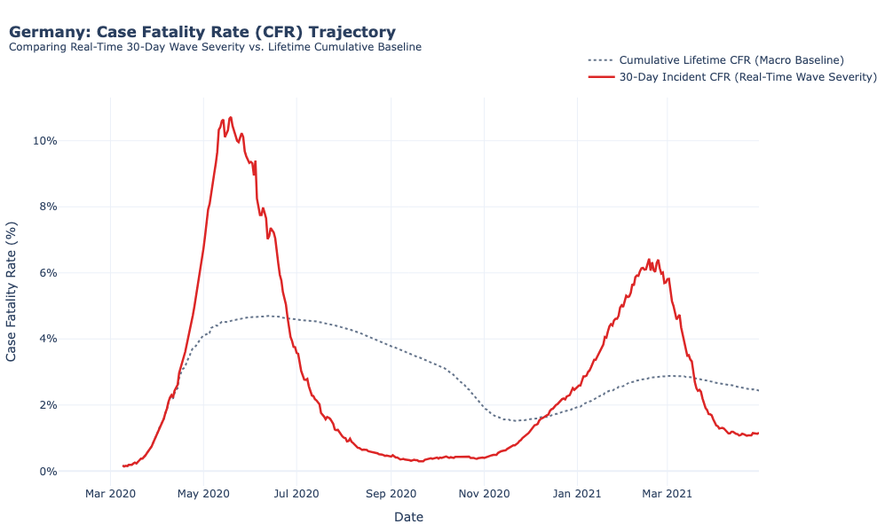
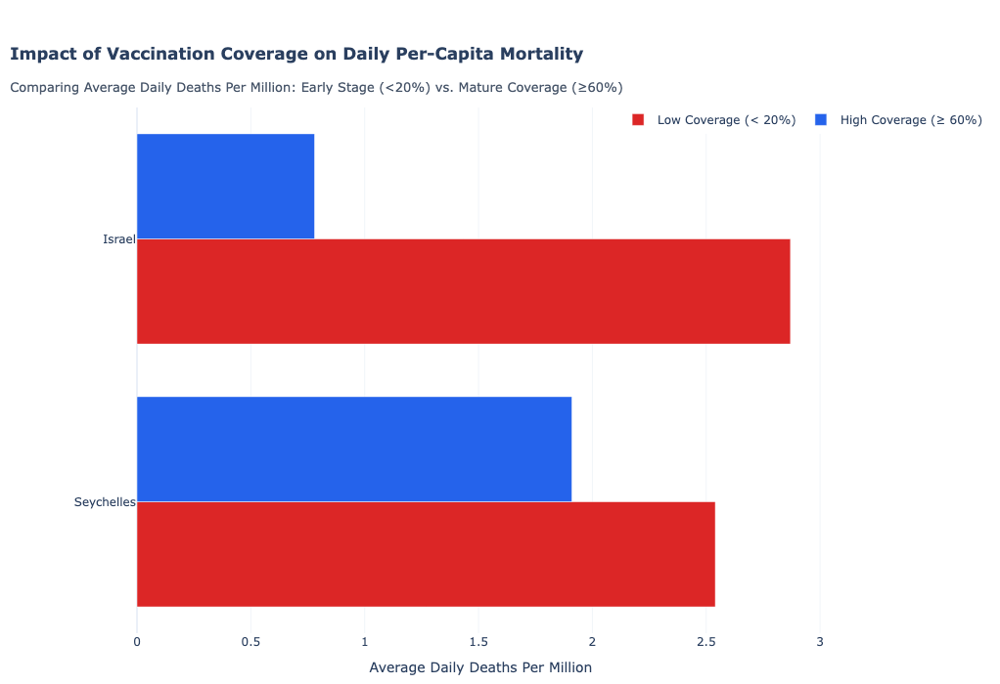
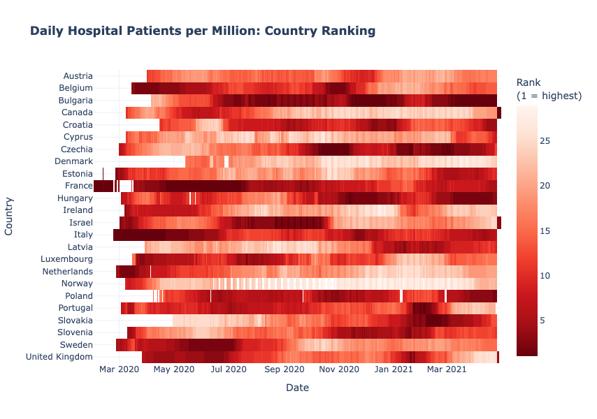
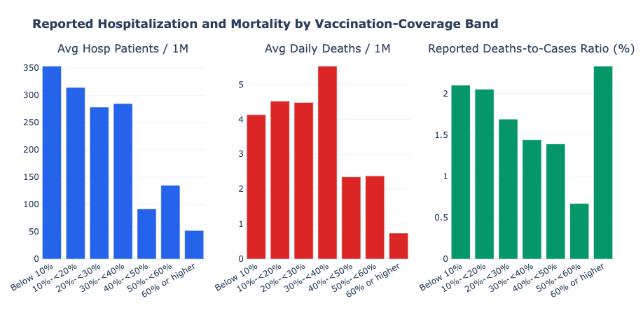

# COVID-19: From Case Waves to Hospital Burden

## Project Background

The COVID-19 pandemic highlighted the importance of understanding how infectious disease trends evolve over time. Reported cases alone cannot capture the full impact of an outbreak; deaths, hospitalizations, and vaccination coverage provide additional perspectives.

This project analyses COVID-19 trends in Germany and across multiple countries, using rolling averages, week-over-week comparisons, and international indicators to explore changes in reported mortality and hospitalization and their associations with vaccination coverage. The aim is to develop a broader, data-driven understanding of pandemic trends.

Using **PostgreSQL** for data querying and analytical calculations, alongside **Python, Pandas, NumPy, and Plotly** for data processing and visualization, this project demonstrates how SQL-based analysis and interactive visualizations can be combined to explore complex public-health datasets.

**Analytical Scope:** This is an exploratory analysis of reported country-level data. The comparisons identify patterns and associations; they are not designed to establish causal effects of vaccination or prove healthcare-system saturation.

---

## The questions behind the analysis

1. **How did the reported outbreak evolve?** Can a seven-day average reveal the underlying case trajectory more clearly than raw daily counts, and how did that average change compared with the previous week?
2. **Did the reported fatality picture change over time?** How does a cumulative case fatality ratio compare with a rolling ratio of deaths to cases reported in a recent window?
3. **How did reported mortality differ across vaccination-coverage levels?** What patterns appear when country-level observations with lower and higher coverage are compared?
4. **Where was reported hospitalization burden relatively high?** How did countries rank against one another when hospital patients are normalized per million people?
5. **Did the indicators move together across vaccination-coverage bands?** How did average hospitalization, daily deaths, and the reported deaths-to-cases ratio vary across coverage levels?

## The analytical journey

### 1. Epidemiological Trends: Daily Cases and Week-over-Week Growth

The first step is to understand the trajectory before trying to interpret severity. Daily case reports are noisy, so the analysis uses a seven-row moving average to make the broader pattern easier to see. It then compares the current seven-day average with the value seven rows earlier to calculate week-over-week change.

**What the saved notebook output shows:**

- The Germany series contains **460 daily observations**, from **27 January 2020 to 30 April 2021**.
- Reported daily cases reach a maximum of **49,044 on 30 December 2020**.
- The seven-day average reaches its maximum of **25,757 on 23 December 2020**.
- On 30 April 2021, the seven-day average is approximately **18,356**; the calculated week-over-week change for that date is approximately **−10.0%**.


The moving average makes the underlying trajectory easier to follow than raw daily counts alone. The week-over-week percentage adds a measure of momentum, but it needs careful interpretation: when the previous week's average is close to zero, percentage changes can become extremely large. The early-March 2020 spikes in this series are an example of a small-baseline effect, not evidence of a comparable absolute increase in later periods.

**Methods:** SQL windowed `AVG()`; Pandas filtering and `.shift(7)`; percentage-change calculation; interactive Plotly subplot.


### 2. Look beyond cases: cumulative and rolling reported fatality ratios

Case counts describe the spread of reported infections, but they do not describe the reported death burden. The second analysis therefore compares two measures for Germany:

- **Cumulative CFR:** cumulative reported deaths divided by cumulative reported cases.
- **Rolling 30-row reported deaths-to-cases ratio:** deaths reported in the current and previous 29 rows divided by cases reported over the same rows.

**What the saved notebook output shows:**

- The cumulative ratio reaches **4.70% on 11 June 2020** and is **2.44% on 30 April 2021**.
- The rolling 30-row ratio reaches **10.72% on 19 May 2020** and is **1.16% on 30 April 2021**.



The two measures answer different descriptive questions. The cumulative ratio reflects the full reporting history up to each date, so it moves slowly. The rolling ratio uses only the last 30 days of reported counts, so it reacts quickly. Both divide reported deaths by reported cases, so neither measures an individual patient's risk of death.

The rolling ratio peaks on 19 May 2020, after reported cases had already fallen from their first peak. This is consistent with a reporting lag: deaths follow diagnosis by days to weeks, so a falling case count inflates the ratio. Limited testing early in the pandemic may also have contributed, since many mild infections went undetected. This analysis does not test either explanation.

**Important terminology:** the rolling measure is not a true incident or cohort case fatality rate. Deaths reported in a period are not necessarily linked to the cases reported in that same period; diagnosis-to-death delays and reporting practices affect the ratio.

**Methods:** PostgreSQL windowed `SUM()` with `PARTITION BY`, `ORDER BY`, and a rolling `ROWS` frame; `NULLIF()` for safe division; numeric casting and rounding; interactive Plotly line chart.


### 3. Bring vaccination coverage into the comparison

The next question is whether reported mortality looks different at lower and higher vaccination-coverage levels. The notebook joins the deaths and vaccination tables by country and date, then compares average daily deaths per million for observations below 20% coverage and observations at or above 60% coverage.

**What the saved chart shows:** after zero and incomplete comparisons are removed, the plotted result contains two countries:

| Country | Average daily deaths / million, coverage below 20% | Average daily deaths / million, coverage at least 60% |
|---|---:|---:|
| Seychelles | 2.54 | 1.91 |
| Israel | 2.87 | 0.78 |



This comparison evaluates the association between vaccination coverage and daily per-capita mortality for qualifying countries. **Only two countries qualify:** because the dataset ends in April 2021, very few nations had reached the 60% coverage threshold by that time, and countries lacking observations in both groups or recording an average of zero were excluded. 

Within this small sample, the average reported daily deaths per million are lower during periods of higher coverage. However, **this is strictly an exploratory association, not an estimate of vaccine effectiveness.** Because low-coverage days fall predominantly earlier in the timeline and high-coverage days later, differences in calendar time, epidemic timing, variants, prior infection, age structure, reporting practices, and other potential confounders could explain part or all of the observed gap. Consequently, due to the limited number of countries featured in the chart, these findings cannot be generalized globally.

**Methods:** SQL join on `location` and `date`; conditional aggregation with `CASE`; grouped horizontal Plotly bar chart.

### 4. Comparing Hospitalization Burden Across Countries

Reported deaths alone do not capture the full impact of a pandemic on health services. This analysis explores how reported hospitalizations varied across countries by ranking them daily based on hospital patients per million people.

**What the saved chart shows:**
* **Dataset Scope:** 449 dates spanning 2 February 2020 to 30 April 2021.
* **Data Hygiene:** To ensure analytical integrity, countries are only retained in the visualization if they possess valid daily reporting observations for at least 75% of the timeline. 
* **Interpreting the Matrix:** Darker red shades indicate a higher relative hospitalization position (Rank 1 representing the highest per-capita burden for that date). White spaces represent missing daily observations (such as weekend reporting lags) rather than zero hospitalizations. These gaps were intentionally left un-imputed to accurately reflect raw data consistency.



**Methodological Note:** 
This ranking is a measure of **relative per-capita hospitalization burden**. It is not a direct measure of actual hospital capacity strain. A true capacity assessment would require dividing these patient counts by the total number of staffed or available hospital beds in each respective country. Furthermore, because rankings are calculated independently for each date, the size of the comparison group fluctuates slightly depending on daily reporting availability.

**Methods:** PostgreSQL `DENSE_RANK()` with `PARTITION BY date`; Pandas `.pivot()` with dynamic percentage-based filtering; Plotly heatmap visualization.

### 5. Compare multiple indicators across vaccination-coverage bands

The final analysis groups country-date observations into seven vaccination-coverage bands, from below 10% to 60% or higher. For each band, it calculates average hospital patients per million, average daily deaths per million, and an aggregate reported deaths-to-cases ratio.

**What the saved chart shows:**



| Vaccination coverage band | Average hospital patients / million | Average daily deaths / million | Aggregate reported deaths-to-cases ratio |
|---|---:|---:|---:|
| Below 10% | 353.58 | 4.13 | 2.10% |
| 10%-<20% | 314.52 | 4.52 | 2.05% |
| 20%-<30% | 278.40 | 4.48 | 1.69% |
| 30%-<40% | 285.00 | 5.52 | 1.44% |
| 40%-<50% | 91.84 | 2.35 | 1.39% |
| 50%-<60% | 134.98 | 2.38 | 0.67% |
| 60% or higher | 52.18 | 0.74 | 2.33% |

In this aggregation, the highest-coverage band has significantly lower average hospitalization and daily deaths per million than the lowest-coverage band. The pattern is **not strictly monotonic** across the intermediate bands. Interestingly, the aggregate reported deaths-to-cases ratio rises to 2.33% in the highest band. This anomaly is a useful reminder that indicators do not tell an identical story: as vaccination scales up and structural relief is achieved, milder cases are often no longer tested or reported. This drastically shrinks the case denominator, artificially inflating the fatality ratio of the few severe cases that are still recorded.

These bands group country-date observations; they are not patient cohorts followed through time. Differences in which countries and dates contribute to each band can influence the averages. To ensure methodological rigor, the SQL query utilizes PostgreSQL `FILTER` clauses to enforce symmetrical sampling for the aggregate ratio. This guarantees that deaths and cases are only summed on days where *both* metrics are actively reported, preventing the severe denominator skew that occurs when treating missing data as zero counts.

**Methods:** SQL `CASE`-based grouping; `AVG()`; `SUM() FILTER (WHERE...)` for symmetrical aggregation; Pandas type conversion; multi-panel Plotly bar chart.

---

### What the analysis suggests and what it does not

Taken together, the notebook illustrates why no single metric is enough to describe a pandemic:

- **Case counts and smoothed averages** describe the reported trajectory; percentage growth also depends heavily on the baseline.
- **Cumulative and rolling reported fatality ratios** provide different time perspectives, but neither should be mistaken for a patient-level probability of death.
- **Vaccination-coverage comparisons** show differences in the observed data, but this macro-level analysis is not designed to isolate a causal vaccination effect.
- **Hospital patients per million** support relative cross-country comparisons, but do not measure occupancy against actual hospital capacity (staffed beds/ICU availability).
- **Coverage-band summaries** reveal broad patterns and highlight the importance of rigorous data hygiene, proving that raw aggregation without controlling for missing reporting days can drastically skew fatality ratios.


## Tools and techniques

| Tool / technique | Role in the project |
|---|---|
| PostgreSQL | Query the COVID-19 deaths and vaccination tables |
| SQL | Filtering, joins, conditional aggregation, grouping, and window functions |
| Window functions | Seven-row averages, rolling sums, and daily country rankings |
| Python | Execute queries and prepare results for visualization |
| Pandas | Filtering, shifting, reshaping, and type conversion |
| NumPy | Represent undefined percentage calculations as `NaN` |
| SQLAlchemy | Connect Python to PostgreSQL |
| Plotly | Interactive time-series charts, grouped bars, and heatmaps |
| Jupyter Notebook | Organize the workflow and document the analysis |

## Data and database

The notebook expects two tables in the `public` schema of a PostgreSQL database:

- `public.coviddeaths`
- `public.covidvaccinations`

The analysis uses country/date observations and fields for reported cases, deaths, deaths per million, hospital patients, ICU patients, hospital patients per million, and people vaccinated per hundred.


## Run the notebook

1. Install PostgreSQL and create or select a database.
2. Import the source data into `public.coviddeaths` and `public.covidvaccinations`.
3. Confirm that the column names and data types match those used in the notebook.
4. Configure the database connection with environment variables rather than hard-coded credentials.
5. Install the Python dependencies:

   ```bash
   pip install pandas numpy sqlalchemy psycopg2-binary plotly jupyter
   ```

6. Start Jupyter and open `Covid19.ipynb`:

   ```bash
   jupyter notebook
   ```


## Repository structure

```text
├── assets/          # Exported static PNG charts referenced in README.md
├── data/            # Source CSV files (CovidDeaths.csv, CovidVaccinations.csv)
├── Covid19.ipynb    # SQL queries, Python analysis and Plotly
├── Covid19.sql      # SQL queries
└── README.md        # Project overview, narrative, and methods
```

---

*Educational and portfolio project. The results are descriptive and exploratory; they are not clinical guidance or causal estimates.*
